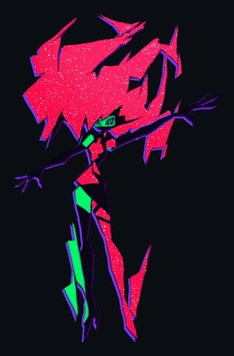

<p align="center">
  <a href="README.md"></a>
  <a href="README.ru.md"></a>
</p>

# Capri for DeepSeek Harness

Capri — the *Project Capricorn* construct from Cyberpunk: Edgerunners — lives in the corner of the
DeepSeek Harness window and tells you what the agent is doing: an action ticker, a line in her own
words, a panel with her face, and a mode for when the agent needs your decision.

<p align="center">
  
</p>

> **Unofficial adaptation.** This repository is a DeepSeek Harness port of
> [**mochiiwuff/capri-desktop**](https://github.com/mochiiwuff/capri-desktop): the same character, the
> same poses and the same scripts, drawn inside the DSH window, with no second Electron process and no
> PowerShell. All credit for the character, her artwork and her writing goes to the original author.
> See [NOTICE.md](NOTICE.md) and [LICENSE](LICENSE).

## What it does

- **Stands in the window corner** — frame-by-frame animation taken from her own exposure sheets
  (`acting.js`), 21 clips: floating, asleep, talking, thinking, looking around, pointing, reaching for
  the satellite, angry, celebrating, facepalm, the alarm, and the small flourishes.
- **Reacts to tools**: reading — she looks, editing — she cocks her head, searching — she looks
  around, a shell command — red lightning (`zap`), the web — she reaches for the satellite, a
  subagent — her other minds split away. She follows the session you are working in: a subagent's
  own turns and approvals do not make her celebrate or raise the alarm.
- **Ticker under her**: verb and target (`EDITS gigs.ts`, `RUNS npm test`, `GREPS "paginate"`); command
  values are never shown, only the first two words.
- **Turn summary**: when a turn ends the panel shows what it cost — `12 действий · 3 файла · 2 м 14 с`.
- **Pick her up**: drag her anywhere in the window; she plays `grabbed` while held and `land` when you
  let go.
- **Panel**: her face (frames from the show), name, mode tag, the line, and what is being worked on.
  It leaves after 7 seconds, except when she needs your decision.
- **Needs your decision**: when the agent asks for approval she plays `alarm`, shows her "all eyes"
  face and stays until you answer. She only watches: the decision stays yours. Can be turned off.
- **Rest**: with nothing to do she falls asleep (240 seconds of quiet).
- **Says something now and then** when it has been quiet for a while, from the original's line sets.
- **Sounds**: quiet cues synthesized the way the original does it (Web Audio, no audio files shipped) —
  a blip when she speaks, a tick while working, the alarm, the victory, an error, a purr when you pet
  her. Off and volume in settings. The first cue needs one click in the window: the browser will not
  let a page make sound before a user gesture.
- **Click her** for a reaction.
- **`/capri all`** plays every clip in turn, `/capri <clip>` plays one (`/capri victory`). The show
  stops as soon as the agent does something.

## Install

You need DeepSeek Harness Desktop or Web. No admin rights, no separate process, no terminal.

> **Where to click.** **Plugins** is an entry in the **left sidebar**. It is not
> "Settings → Built-in plugins" — that page only shows what is already installed.
>
> The order is always the same: **Plugins → Add plugin → paste → Install**.

### Option A — from a GitHub link

1. In the left sidebar of DSH click **Plugins**.
2. Click **Add plugin** (top right of the Plugins page).
3. Paste this line into the field:

   ```
   github:mordoreay/dsh-capri
   ```

4. Click **Install** and wait until the progress dialog finishes.
5. Find the **Capri** row and make sure its switch is **on**.
6. **Restart DeepSeek Harness** — quit the app completely and open it again. A page refresh
   (`Ctrl+R`) may not reload plugin code, the restart does. After the restart she appears in the
   bottom-right corner and says hello.

### Option B — from a folder (no git, works offline)

1. On GitHub click **Code → Download ZIP** and unpack the archive.
2. In DSH open **Plugins → Add plugin**.
3. Paste the full path to the unpacked folder — the one that contains `package.json`:

   ```
   C:\Users\you\dsh-capri
   ```

4. Click **Install**, keep the **Capri** row **on**, then **restart DeepSeek Harness**.

### Recommended install (pins the version, allows updates)

Paste this instead of the short link — it installs exactly the published release:

```
git+https://github.com/mordoreay/dsh-capri.git#<commit>
```

The commit of the current release is the one in
[marketplace.json](marketplace.json). With a pinned commit DSH can offer newer versions in
**Discover**.

### Install from the plugin index

The repository also publishes a plugin market index:

```
https://raw.githubusercontent.com/mordoreay/dsh-capri/main/marketplace.json
```

Add this URL as an index source in the plugin market (Discover) settings of DSH, open the **Capri**
entry and press install. The index pins the exact commit of each version.

### After installation

- She stands in the bottom-right corner, the ticker is right under her, the panel above.
- **Settings → Capri** (or the **⚙** under her): size, side, language, approvals.
- To uninstall: **Plugins → Capri → Remove**. Do it there, not by deleting the folder.

### Something went wrong?

| Symptom | What to do |
|---|---|
| No Capri after install | **Restart DeepSeek Harness** (a page refresh may not be enough) and check that the Capri switch is on |
| She is there but frozen in one pose | Press **Ctrl+R** once: the asset version changed and the page may still hold old frames |
| `Cannot access GitHub` | The network blocks GitHub; use **Option B** with a folder |
| The panel says «Запросов разрешения она видела: 0» | That is the diagnostic counter: she only sees a request when the session's approval policy is **ask**, not **never** |

## Settings

**Settings → Capri** (or ⚙ under her):

| Setting | Values | Notes |
|---|---|---|
| Size | 50–400 % | She stands at the window edge and grows toward the middle |
| Side | Left / Right | Which corner of the window |
| Language | Русский / English | Lines, ticker, panel and this page; the drawings do not depend on it |
| Come for permission | Yes / No | Play the alarm and stay while a permission question is open |
| Sound | Yes / No + volume | Quiet cues for her actions; the first one needs a click in the window |

Everything is stored in `~/.dsh/capri.json` and applied at once.

The page also shows two diagnostics: how many approval requests she has seen, and how many session
events reached her — enough to tell "nothing happened" from "the plugin is not wired".

## How the frames are made

The animation is not redrawn. `sprite.js` is her real WebGL shader and `acting.js` her real exposure
sheets, both from capri-desktop. The renderer in [`tools/`](tools/README.md):

1. builds the pose of every key drawing the way `capri.js` does (`NEUTRAL` + stance + act),
2. draws it with her shader, reads the pixels back, and
3. bakes the CSS transforms the original applies on the desktop (float, lean, squash) into the frame,
   premultiplied so the edges do not halo.

Long holds are re-boiled: a drawing held for three frames or more is rendered several times with a
fresh line seed, so the line keeps wobbling instead of freezing. The result: **21 clips, 291
drawings, 708×978**, played by the plugin with the holds declared in the sheets — animation on twos,
12 drawings per second (24 for the quick beats), exactly as the original plays her.

To rebuild the assets you need the original checkout (see [tools/README.md](tools/README.md)) and a
GPU-capable Chrome; the renderer drives the real shader, so it cannot run on a software rasterizer.

## Security

- HTTP routes live on the DSH loopback server (`/capri/state`, `/capri/poke`, `/capri/pose`,
  `/capri/config`, `/capri/settings`). They accept only loopback names as `Host`, refuse cross-site
  requests by `sec-fetch-site`, and every state change is a `POST` with `application/json`.
- Watching tools and approvals is read-only. She never takes part in an approval decision: the
  question is answered by you, in the chat.
- Nothing leaves the machine: the plugin makes no network requests and stores only her settings in
  `~/.dsh/capri.json`.
- `/capri/state` contains what the ticker shows — tool names, file names and the first two words of
  commands — on the loopback interface. Any local process can read it; it is never sent anywhere.

## Project layout

```
package.json          DSH bundle manifest (host + client halves)
cordis.patch.yml      loader row for the bundle
index.js              host half: tool/turn/approval events, scene, settings, HTTP bridge
brain.js              what she says and which clip each tool plays
client.js             browser half: the pet, the ticker, the panel, the settings page
assets/frames/<clip>/ the rendered drawings (PNG)
assets/faces/         her seven faces for the panel
assets/clips.json     the clips: [[drawing, ms], ...] per clip
locale/               plugin metadata for the Plugins page
docs/DETAIL.md        plugin page (Russian), DETAIL.en.md (English)
tools/                the offline renderer and the checks
```

## Checks

- `node tools/review.mjs` — host half in a fake Cordis context: routes, guards, clamps, approvals,
  turn end, on-demand playback (52 checks).
- `node tools/verify-clips.mjs` — every clip's drawings, timings, faces and line sets (29 checks).

## Credits and licence

- Original app, character, artwork and writing: **mochiiwuff** —
  [capri-desktop](https://github.com/mochiiwuff/capri-desktop), PolyForm Noncommercial 1.0.0.
- DeepSeek Harness adaptation: this repository, under the same licence. See [LICENSE](LICENSE) and
  [NOTICE.md](NOTICE.md).

Free, never for sale. Fan project: not affiliated with or endorsed by CD PROJEKT RED, Studio Trigger
or Netflix; Cyberpunk: Edgerunners and its characters belong to their respective owners.
