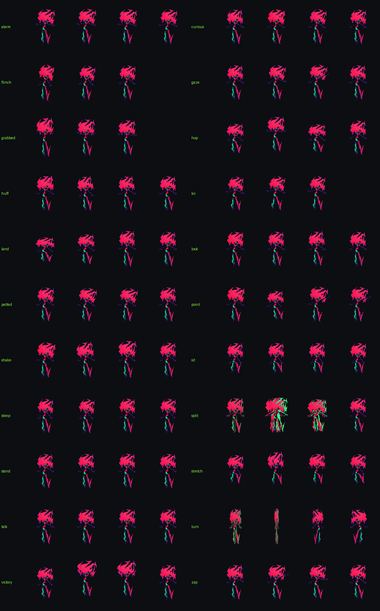

[English](README.md) | **Русский**

# Capri для DeepSeek Harness

Капри — конструкт *Project Capricorn* из Cyberpunk: Edgerunners — живёт в углу окна DeepSeek Harness
и рассказывает, чем занят агент: тикер действия, реплика её голосом, панель с её лицом и отдельный
режим для случая, когда агенту нужно твоё решение.



> **Неофициальная адаптация.** Это порт [**mochiiwuff/capri-desktop**](https://github.com/mochiiwuff/capri-desktop)
> под DeepSeek Harness: тот же персонаж, те же позы и те же тексты, но рендер внутри окна DSH, без
> второго Electron-процесса и без PowerShell. Все права на персонажа, арт и реплики принадлежат
> автору оригинала. См. [NOTICE.md](NOTICE.md) и [LICENSE](LICENSE).

## Что делает

- **Стоит в углу окна** — покадровая анимация из её собственных экспошкурок (`acting.js`), 21 клип:
  парение, сон, разговор, раздумья, взгляд по сторонам, указание, тянущаяся к спутнику рука, злость,
  победа, фейспалм, тревога и мелкие приёмы.
- **Реагирует на инструменты**: чтение — смотрит, правка — склоняет голову, поиск — оглядывается,
  команда в оболочке — красная молния (`zap`), выход в сеть — тянется к спутнику, подагент — её
  «другие она» расходятся.
- **Тикер под ней**: глагол и цель (`EDITS gigs.ts`, `RUNS npm test`, `GREPS "paginate"`); значения
  команд не показываются — только первые два слова.
- **Панель**: её лицо (кадры из сериала), имя, тег режима, реплика и строка дела. Уходит сама через
  7 секунд, кроме режима «нужно разрешение».
- **Нужно твоё решение**: когда агент просит подтверждение, она играет тревогу (`alarm`), показывает
  лицо «все глаза» и остаётся, пока ты не ответишь. Она только смотрит: решение остаётся за тобой.
  Отключается в настройках.
- **Отдых**: без дела она засыпает (240 секунд тишины).
- **Иногда говорит сама**, если стало совсем тихо — фразами из наборов автора оригинала.
- **Клик по ней** — реакция и реплика.
- **`/capri all`** — показать все клипы по очереди, `/capri <клип>` — один (`/capri victory`). Показ
  прерывается, как только агент что-то делает.

## Установка

Нужен DeepSeek Harness Desktop или Web. Никаких прав администратора, отдельных процессов и терминала.

> **Куда нажимать.** **Plugins** — это пункт в **левой панели**. Это не «Настройки → Встроенные
> плагины»: та страница показывает только уже установленное.
>
> Порядок всегда один: **Plugins → Add plugin → вставить → Install**.

### Вариант A — по ссылке на GitHub

1. В левой панели DSH нажми **Plugins**.
2. Нажми **Add plugin** (справа вверху на странице Plugins).
3. Вставь в поле строку:

   ```
   github:mordoreay/dsh-capri
   ```

4. Нажми **Install** и дождись конца установки.
5. Найди строку **Capri** и убедись, что переключатель **включён**.
6. **Перезапусти DeepSeek Harness** — закрой приложение полностью и открой заново. Обновление
   страницы (`Ctrl+R`) код плагина может не подхватить, перезапуск подхватит. После него она
   появится в правом нижнем углу и поздоровается.

### Вариант B — из папки (без git, работает офлайн)

1. На GitHub нажми **Code → Download ZIP** и распакуй архив.
2. В DSH открой **Plugins → Add plugin**.
3. Вставь полный путь к распакованной папке — той, где лежит `package.json`:

   ```
   C:\Users\you\dsh-capri
   ```

4. Нажми **Install**, оставь строку **Capri** включённой и **перезапусти DeepSeek Harness**.

### Рекомендуемая установка (фиксирует версию, разрешает обновления)

Вставь это вместо короткой ссылки — установится ровно опубликованный выпуск:

```
git+https://github.com/mordoreay/dsh-capri.git#<commit>
```

Коммит текущего выпуска указан в [marketplace.json](marketplace.json). С зафиксированным коммитом DSH
сможет предлагать новые версии в **Discover**.

### Установка из индекса плагинов

Репозиторий публикует индекс плагинов:

```
https://raw.githubusercontent.com/mordoreay/dsh-capri/main/marketplace.json
```

Добавь этот адрес как источник индекса в настройках магазина плагинов (Discover) в DSH, открой
запись **Capri** и нажми установить. Индекс фиксирует точный коммит каждой версии.

### После установки

- Она стоит в правом нижнем углу, тикер прямо под ней, панель над ней.
- **Настройки → Capri** (или **⚙** под ней): размер, сторона, язык, разрешения.
- Удалить: **Plugins → Capri → Remove**. Именно там, а не удаляя папку.

### Что-то пошло не так?

| Симптом | Что делать |
|---|---|
| Капри не появилась | **Перезапусти DeepSeek Harness** (обновление страницы может не помочь) и проверь, что переключатель Capri включён |
| Она есть, но застыла в одной позе | Нажми **Ctrl+R** один раз: версия ассетов изменилась, страница может держать старые кадры |
| `Cannot access GitHub` | Сеть блокирует GitHub — используй **вариант B** с папкой |
| В панели «Запросов разрешения она видела: 0» | Это счётчик-диагностика: она видит запрос только когда политика подтверждений в сессии **ask**, а не **never** |

## Настройки

**Настройки → Capri** (или ⚙ под ней):

| Настройка | Значения | Что делает |
|---|---|---|
| Размер | 50–400 % | Стоит у края окна и при увеличении растёт к центру |
| Сторона | Слева / Справа | В каком углу окна |
| Язык | Русский / English | Реплики, тикер, панель и эта страница; кадры от языка не зависят |
| Приходить за разрешением | Да / Нет | Играть тревогу и оставаться, пока висит вопрос подтверждения |

Всё хранится в `~/.dsh/capri.json` и применяется сразу.

На той же странице две диагностики: сколько запросов подтверждения она видела и сколько событий
сессии до неё дошло — этого достаточно, чтобы отличить «ничего не происходило» от «плагин не
подключён».

## Как сделаны кадры

Анимация не перерисована. `sprite.js` — её настоящий WebGL-шейдер, `acting.js` — её настоящие
экспошкурки, оба из capri-desktop. Рендерер в [`tools/`](tools/README.md):

1. собирает позу каждого ключевого рисунка так же, как `capri.js` (`NEUTRAL` + стойка + акт);
2. рисует её её же шейдером и читает пиксели обратно;
3. запекает в кадр CSS-трансформы, которые оригинал применяет на рабочем столе (парение, наклон,
   сквош), премультиплицируя альфу, чтобы края не светились ореолом.

Длинные держания «кипят»: рисунок, который держится три кадра и дольше, рендерится несколько раз с
новым сдвигом линий, поэтому линия продолжает дрожать, а не замирает. Итог: **21 клип, 291 рисунок,
708×978**, плагин проигрывает их с задержками из шкурок — анимация на двойках, 12 рисунков в секунду
(24 для быстрых актов), ровно как в оригинале.

Чтобы пересобрать ассеты, нужен чекаут оригинала (см. [tools/README.md](tools/README.md)) и Chrome
с настоящим GPU: рендерер гоняет реальный шейдер и на программном растеризаторе не работает.

## Безопасность

- HTTP-маршруты живут на loopback-сервере DSH (`/capri/state`, `/capri/poke`, `/capri/pose`,
  `/capri/config`, `/capri/settings`). Они принимают только loopback-имена в `Host`, отбивают
  cross-site запросы по `sec-fetch-site`, а любое изменение состояния — это `POST` с
  `application/json`.
- Наблюдение за инструментами и подтверждениями только читающее. Она не участвует в решении о
  подтверждении: на вопрос отвечаешь ты, в чате.
- Ничего никуда не уходит: плагин не делает сетевых запросов, а из данных хранит только настройки в
  `~/.dsh/capri.json`.
- `/capri/state` содержит то, что показывает тикер, — имена инструментов, файлов и первые два слова
  команд — на loopback-интерфейсе. Любой локальный процесс может это прочитать; наружу ничего не
  отправляется.

## Структура проекта

```
package.json          манифест бандла DSH (host + client)
cordis.patch.yml      строка загрузчика для бандла
index.js              host: события инструментов/хода/подтверждений, сцена, настройки, HTTP-мост
brain.js              что она говорит и какой клип играет на каждый инструмент
client.js             browser: питомец, тикер, панель, страница настроек
assets/frames/<клип>/ отрендеренные рисунки (PNG)
assets/faces/         её семь лиц для панели
assets/clips.json     клипы: [[рисунок, мс], ...] для каждого
locale/               метаданные плагина для страницы Plugins
docs/DETAIL.md        страница плагина (русский), DETAIL.en.md (английский)
tools/                офлайн-рендерер и проверки
```

## Проверки

- `node tools/review.mjs` — host-половина в фейковом Cordis-контексте: маршруты, гарды, клэмпы,
  подтверждения, конец хода, показ по команде (52 проверки).
- `node tools/verify-clips.mjs` — рисунки, тайминги, лица и наборы реплик для всех клипов (29 проверок).

## Авторы и лицензия

- Оригинальное приложение, персонаж, арт и тексты: **mochiiwuff** —
  [capri-desktop](https://github.com/mochiiwuff/capri-desktop), PolyForm Noncommercial 1.0.0.
- Адаптация под DeepSeek Harness: этот репозиторий, на той же лицензии. См. [LICENSE](LICENSE) и
  [NOTICE.md](NOTICE.md).

Бесплатно, никогда не на продажу. Фанатская работа: не связана с CD PROJEKT RED, Studio Trigger и
Netflix и не одобрена ими; Cyberpunk: Edgerunners и её персонажи принадлежат их правообладателям.
